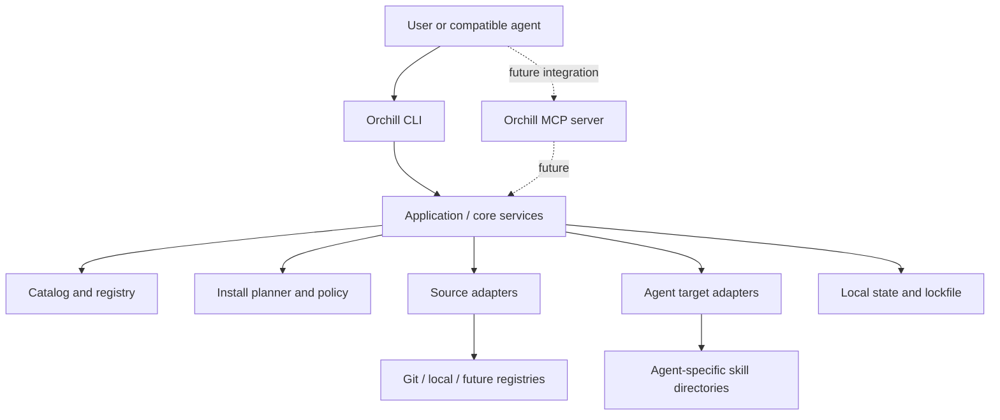

# Orchill — Project Journal

> **Purpose:** This file is the running source of truth for Orchill's product decisions, requirements, architecture, implementation status, and next steps.
>
> **Journal rule:** Distinguish between **Decided**, **Proposed**, **Drafted**, **Implemented**, and **Verified**. A plan or generated starter is not proof that a feature exists in this GitHub repository.

## 1. Project at a glance

- **Project name:** Orchill
- **Repository:** https://github.com/Audaa-Cyber/orchill
- **Default branch:** `main`
- **Product category:** CLI-first AI-agent skill manager / package manager
- **Primary goal:** Let a person or compatible agent discover, select, install, and manage individual skills without downloading an entire skill collection.
- **Current repository state at journal creation:** GitHub reports that the repository is empty. No existing source files or implementation were available to inspect.
- **Package publication:** Not verified. A previous `npm view orchill name` attempt did not find a publicly retrievable package with that exact name. This is not a guarantee that the name is available; npm's publish-time checks are authoritative.

## 2. Product vision

Orchill should make skills reusable, organized, discoverable, and installable in a predictable way.

A user should be able to install or invoke Orchill, browse skill categories, find a particular capability, and install only the skill or skills they need. When a skill contains supporting files and nested folders, Orchill should preserve the complete directory structure rather than copying only a single instruction file.

Orchill should work as a useful standalone CLI first, while being designed so compatible agent environments can later access it through integrations such as an MCP server.

### Core user problem

Skills are often distributed across repositories and collections. Finding the right skill, understanding what it does, and installing it into the correct agent-specific location can be inconsistent or require manual copying. Installing an entire collection just to use one skill is wasteful.

### Product principles

1. **Selective by default:** Discovering skills must not require downloading every skill.
2. **Preserve structure:** Copy all files and subdirectories belonging to a selected skill.
3. **Organized catalog:** Keep categories, names, descriptions, source references, and compatibility metadata understandable.
4. **Agent-aware:** Support different installation targets through explicit adapters rather than assuming every agent uses the same directory or format.
5. **Transparent:** Preview what will be installed and where; report source and outcome.
6. **Safe by default:** Do not automatically execute third-party skill scripts. Validate paths and sources, handle overwrites deliberately, and expose provenance and licensing information where known.
7. **Composable:** Keep the CLI, catalog, source adapters, installation engine, agent adapters, and future integrations modular.
8. **Honest compatibility:** State which integrations are tested instead of implying every chat product can access local files.

## 3. User requirements and use cases

### A. Install one skill

The user searches for a skill by name or capability, inspects its metadata, then installs only that skill into a chosen target.

Illustrative flow:

```sh
orchill search "frontend design"
orchill info frontend-design
orchill install frontend-design
```

These commands describe the intended interface; they are not all verified as implemented in this repository.

### B. Install by category

The user can browse categories such as UI/UX design, animation, or micro-interactions and install a selected category's skills.

Illustrative flow:

```sh
orchill categories
orchill list --category "Animation & Motion"
orchill install --category "Animation & Motion"
```

Category installation should show a preview and make it clear which individual skills will be installed. It must not silently install the entire global catalog.

### C. Agent requests a capability

A compatible agent or an operator may request a specific skill or capability. Orchill searches its catalog, presents relevant matches, and installs only the approved selection.

A vague request such as “make this page feel more polished” could map to multiple capabilities—design, motion, accessibility, or micro-interactions—but automatic mapping and installation are future behavior until implemented. The system should avoid silently making broad or risky installations.

### D. Preserve complete skill folders

If a source skill has a structure such as:

```text
some-skill/
├── SKILL.md
├── references/
│   └── guidelines.md
├── scripts/
│   └── helper.py
└── assets/
    └── example.svg
```

Orchill should preserve the skill's files and nested folders when installing it, subject to safety rules and explicit exclusions documented by the source or installer. It should not flatten the directory or install unrelated sibling skills.

### E. Work across agents

The architecture should support agent-specific target paths and formats. Candidate targets discussed so far include Claude Code, GitHub Copilot, Cursor, Codex, and a generic agents directory. The correct path and format must be verified per target and may vary by operating system and configuration.

### F. CLI versus chat agents

A CLI is useful for a person or an agent runtime that can execute shell commands, but a CLI alone does **not** automatically make Orchill available inside a hosted ChatGPT or Claude conversation.

A future MCP server could expose controlled tools such as search, inspect, and install to compatible clients. Each client must be configured to connect to that server and grant the required permissions. Installing files on one computer does not guarantee a cloud-hosted chat agent can see those files.

## 4. Candidate skill categories

Initial categories discussed:

- UI/UX Design
- Frontend & React
- Animation & Motion
- Micro-interactions
- Accessibility
- Design Systems & Components
- Performance
- Testing & Quality
- SEO & Marketing
- Content & Social Media
- API & Backend
- Documentation & Office Files
- Security & Static Analysis
- Tooling & MCP Development
- Data & Automation

These are a proposed starting taxonomy, not a final locked list. Category identifiers should be stable machine-readable slugs, with display names and descriptions stored separately.

## 5. Candidate skill sources mentioned

The following names were mentioned as possible sources or examples to investigate. **Their exact repositories, ownership, licensing, current contents, and install paths have not all been verified in this journal.** Do not treat this list as an approved registry or as proof that any item is installable.

- Taste Skill — Leonxlnx
- Emil Design Engineering — Emil Kowalski
- Build Awwwards-Quality Sites — Meng To
- Find Skills — Vercel Labs
- React Best Practices — Vercel Labs
- Frontend Design — Anthropic
- Marketing Skills — Corey Haines
- Claude SEO — Daniel Agrici
- Social Media Skills — Charlie Hills
- MCP Builder — Anthropic
- Static Analysis — Trail of Bits
- Claude API — Anthropic
- DOCX — Anthropic
- shadcn/ui — shadcn

Before adding any candidate to a production registry, verify its canonical source URL, exact skill subdirectory, license, provenance, maintenance status, and compatibility. A name alone is not a sufficient source reference.

## 6. Architecture direction

### High-level design

Orchill is intended to have a CLI-first modular core.



The diagram is an architectural plan, not a claim that every box exists in code.

### Major modules

- **CLI:** Parse arguments, display help, show progress and errors.
- **Application services:** Coordinate search, inspection, planning, installation, update, and removal.
- **Catalog/registry:** Store skill metadata and references to source locations. The registry should not need to contain a copy of every skill.
- **Registry schema:** Validate metadata, IDs, categories, source definitions, targets, versions, and optional license information.
- **Source adapters:** Fetch from local directories, Git repositories and subdirectories, then potentially approved marketplaces or remote registries.
- **Search and ranking:** Match exact IDs, names, tags, descriptions, and capabilities.
- **Install planner:** Resolve the selected skill, destination, conflicts, and any declared dependencies before writing files.
- **Installer:** Retrieve and copy the selected skill's complete folder safely.
- **Agent adapters:** Determine supported formats and target paths for each agent.
- **State store:** Track installed skills, source/version details, and enough information to update, verify, or uninstall safely.
- **Policy/security layer:** Validate paths, handle symlinks and traversal attempts, protect unrelated files, and require deliberate overwrite behavior.
- **Future MCP adapter:** Expose narrowly scoped, permission-aware operations to configured compatible clients.

### Example registry record (illustrative)

```json
{
  "id": "frontend-design",
  "name": "Frontend Design",
  "description": "Guidance for building polished frontend interfaces.",
  "category": "frontend-react",
  "tags": ["frontend", "ui", "design"],
  "source": {
    "type": "git",
    "repository": "VERIFIED_REPOSITORY_URL",
    "path": "VERIFIED/SKILL/SUBDIRECTORY",
    "ref": "PINNED_TAG_OR_COMMIT"
  },
  "license": {
    "spdx": null,
    "status": "unverified"
  },
  "targets": [],
  "status": "candidate"
}
```

The placeholders are deliberate. Never put an unverified repository path into a production registry as though it were confirmed.

## 7. CLI design direction

The intended command surface includes:

- `orchill --help` — show usage.
- `orchill search <query>` — search the catalog.
- `orchill categories` — show available categories.
- `orchill list [--category <category>]` — list skills, optionally filtered.
- `orchill info <skill-id>` — inspect a skill's details and source.
- `orchill install <skill-id>` — install a selected skill.
- `orchill install --category <category>` — preview/install selected category skills.
- `orchill update [skill-id]` — update installed skill(s).
- `orchill uninstall <skill-id>` — remove a managed installation.
- `orchill verify [skill-id]` — verify installation state/integrity.
- `orchill sources` — inspect configured sources.
- `orchill doctor` — diagnose environment, target, and configuration.
- `orchill config` — inspect or update configuration.

The command list is a target interface; individual commands must be tested before being marked implemented.

## 8. Agent integration and MCP strategy

### Phase 1 — CLI
Make Orchill reliable for local command-line use. Support explicit destinations and documented agent adapters. Provide useful behavior even without any MCP client.

### Phase 2 — agent adapters
Add and test integrations one at a time. Document per-agent paths, supported skill format, restart/reload expectations, and known limitations.

### Phase 3 — MCP
Design an MCP server for compatible clients, with tools conceptually similar to:
- Search the catalog.
- Inspect a skill.
- Preview an installation.
- Install a specifically selected skill after the configured permission policy is satisfied.
- List installed skills.

Prefer read-only discovery by default. Installation is a filesystem-changing operation and should have clear scope, destination, and user/host permission. Do not expose arbitrary shell execution as an installation shortcut.

## 9. Security and trust requirements

Security is a core requirement, not a later polish task.

- Validate skill IDs and reject path traversal.
- Constrain writes to approved destination directories.
- Handle symlinks safely and prevent writes outside the selected target.
- Do not execute scripts from a skill merely because it is being installed.
- Show the source repository and selected path before installation.
- Avoid overwriting existing files without a clear policy and user confirmation.
- Make partial failures recoverable; do not leave ambiguous state.
- Record version/commit/source metadata when available.
- Verify or clearly label unknown licensing; do not imply permission to redistribute.
- Prefer immutable commit/tag references for reproducible installs.
- Avoid downloading every skill as a way to implement search.
- Test malicious path names, malformed registry records, symlinks, collisions, interrupted installs, and untrusted source content.

## 10. Product roadmap

### P0 — reliable MVP

- [ ] Define and validate a versioned registry schema.
- [ ] Implement a clean CLI command structure.
- [ ] Implement catalog search, listing, categories, and skill inspection.
- [ ] Support selective installation from local and Git sources.
- [ ] Preserve nested files and directory structure.
- [ ] Verify the actual source subdirectory before using each Git source.
- [ ] Add explicit target selection and initial tested agent adapters.
- [ ] Preview planned writes and detect conflicts.
- [ ] Add safe path handling and no-implicit-script-execution behavior.
- [ ] Add unit, integration, and security tests.
- [ ] Document install, configuration, errors, and limitations.

### P1 — lifecycle and quality

- [ ] Add installation state tracking.
- [ ] Add pinned versions/commits and a lockfile.
- [ ] Implement update, uninstall, and verify commands.
- [ ] Add rollback or cleanup for interrupted/failed installations.
- [ ] Add provenance and license fields/checks.
- [ ] Model dependencies and conflicts if the catalog needs them.
- [ ] Add registry/source configuration and a doctor command.
- [ ] Add compatibility tests for each supported agent.
- [ ] Evaluate remote catalog distribution and contribution workflow.

### P2 — agent-native experience

- [ ] Implement an MCP server for compatible clients.
- [ ] Add permission-aware search, inspection, preview, and install tools.
- [ ] Add richer capability-based matching/ranking.
- [ ] Consider a terminal UI or graphical catalog if user demand warrants it.
- [ ] Consider team/private registries and community publishing workflows.

## 11. Earlier prototype and documents

Before this GitHub repository was identified, a starter project was generated in the conversation workspace and packaged as `orchill-cli-starter.zip`. A separate combined documentation ZIP was also generated.

The prototype was described as containing:
- A Node.js ESM package named `orchill` with a CLI entry point.
- Basic CLI commands for categories, listing, search, install, and destination reporting.
- A small sample registry and a local example skill.
- Local/Git source installation logic.
- A README and draft documentation.

Draft documents created outside this GitHub repository:
- `docs/PRD.md`
- `docs/ARCHITECTURE.md`
- `docs/STRUCTURE.md`

**Important status distinction:** These generated files were in the prior conversation's downloadable workspace. At the time this journal was written, the GitHub repository was empty, so those files were not verified as committed here. They should be reviewed and ported into the repository deliberately. The initial prototype was not described as production-hardened; schema validation, safe installation policies, robust state tracking, lifecycle commands, and MCP integration remained gaps.

## 12. Repository structure target

A possible structure, to evolve as implementation grows:

```text
orchill/
├── bin/
│   └── orchill.js
├── src/
│   ├── cli.js
│   ├── commands/
│   │   ├── search.js
│   │   ├── categories.js
│   │   ├── list.js
│   │   ├── info.js
│   │   ├── install.js
│   │   ├── update.js
│   │   ├── uninstall.js
│   │   ├── verify.js
│   │   └── doctor.js
│   ├── core/
│   │   ├── catalog.js
│   │   ├── registry-schema.js
│   │   ├── planner.js
│   │   ├── installer.js
│   │   ├── state-store.js
│   │   ├── policy.js
│   │   └── errors.js
│   ├── sources/
│   │   ├── source-adapter.js
│   │   ├── local-directory.js
│   │   └── git-subdirectory.js
│   ├── agents/
│   │   ├── agent-adapter.js
│   │   ├── claude-code.js
│   │   ├── github-copilot.js
│   │   ├── cursor.js
│   │   └── codex.js
│   ├── search/
│   │   ├── matcher.js
│   │   └── ranking.js
│   └── utils/
│       ├── paths.js
│       ├── fs-safe.js
│       └── logger.js
├── registry/
│   ├── skills.json
│   ├── categories.json
│   └── schemas/
│       └── skill.schema.json
├── examples/
│   └── orchill-example-local/
│       └── SKILL.md
├── tests/
│   ├── unit/
│   ├── integration/
│   ├── security/
│   └── fixtures/
├── docs/
│   ├── PRD.md
│   ├── ARCHITECTURE.md
│   ├── STRUCTURE.md
│   ├── SECURITY.md
│   ├── CONTRIBUTING.md
│   └── AGENT-COMPATIBILITY.md
├── .github/
│   └── workflows/
│       └── ci.yml
├── package.json
├── README.md
├── LICENSE
├── .gitignore
└── journal.md
```

This is an intended layout, not the current file tree. Create directories only when the corresponding implementation or documentation is ready.

## 13. Decisions log

| Decision | Status | Notes |
|---|---|---|
| Build Orchill as a skill manager/package manager, not one giant all-purpose skill | Decided | The catalog contains independently selectable skills. |
| Make the CLI the initial interface | Decided | It is useful for humans and agents that can execute commands. |
| Add MCP as a later integration for compatible chat/agent clients | Direction agreed | A CLI alone does not automatically integrate with hosted chats. |
| Install only selected skills by default | Decided | Category install should also show exactly what will be installed. |
| Preserve nested files and folders | Decided | Do not flatten a skill's directory structure. |
| Keep metadata/catalog separate from downloaded skill payloads | Proposed architecture | Avoid requiring the full catalog to be downloaded just to search. |
| Support several agent-specific destinations through adapters | Direction agreed | Verify paths and behavior before calling a target supported. |
| Include strong install safety, source provenance, and license awareness | Requirement | Do not execute skill scripts automatically. |
| Use a root-level `journal.md` in the GitHub repo instead of Notion | Decided | This request supersedes the earlier Notion-journal plan. |

## 14. Open questions to resolve during implementation

- What should the default installation target be when more than one agent is detected?
- Should installs be project-local, user-global, or both?
- What is the canonical registry distribution model: bundled starter registry, remote registry, or both?
- What minimum metadata is mandatory for a skill to be published?
- How should versioning work for sources without releases or tags?
- Should category installation require per-skill confirmation or one clear confirmation for the reviewed list?
- What are the exact supported skill formats and compatibility requirements for each agent?
- What should be the package manager's policy for duplicate IDs, aliases, dependencies, and conflicting skills?
- How should a future MCP server authorize filesystem-changing operations?

## 15. Next actions

1. **Bootstrap this empty GitHub repository** with the reviewed starter CLI, package metadata, README, registry schema, and tests.
2. Port the PRD, architecture, and repository-structure drafts into `docs/`.
3. Make the registry schema and safe path policy part of the first implementation, not afterthoughts.
4. Verify source URLs and exact skill paths before publishing any candidate as installable.
5. Implement and test search, category listing, inspection, and selective installation.
6. Test preservation of nested files and safe handling of conflicts and failed installs.
7. Add installation-state tracking before implementing update/uninstall.
8. Verify target paths for each agent and document tested compatibility.
9. Add MCP only after the core installation flow is reliable.
10. Update this journal when decisions change, features are implemented, tests pass, or release milestones are reached.

## 16. Journal maintenance convention

For each significant milestone, append a dated entry with:
- **Date**
- **Context / request**
- **Decision**
- **Files changed**
- **Implementation status**
- **Tests or verification performed**
- **Remaining work**

When a feature is only proposed, mark it **Proposed**. When files are drafted but not committed, mark them **Drafted outside repository**. Use **Implemented** only when code is present, and **Verified** only when an appropriate check or test has actually succeeded.

---

## 17. Initial journal entry

### 2026-10-29 — Repository discovery and journal initialization

- **Context:** The project owner asked to stop using Notion and journal the entire Orchill project in a root-level `journal.md` in the newly created GitHub repository.
- **Repository located:** [Audaa-Cyber/orchill](https://github.com/Audaa-Cyber/orchill).
- **Default branch:** `main`.
- **Inspection result:** GitHub returned “This repository is empty” for the root contents endpoint. There was no existing code to review.
- **Action:** Create this journal as the first project-history and planning document.
- **Status:** Product vision and architecture are documented here; application code is not yet verified in this repository.
- **Next:** Bootstrap the repository and bring reviewed starter implementation and docs into version control.
