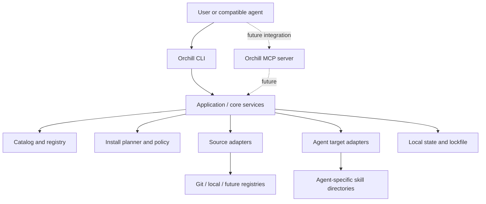

# Orchill — Project Journal

> **Purpose:** This file is the running source of truth for Orchill's product decisions, requirements, architecture, implementation status, and next steps.
>
> **Journal rule:** Distinguish between **Decided**, **Proposed**, **Drafted**, **Implemented**, and **Verified**. A plan or generated starter is not proof that a feature exists in this GitHub repository.

## 1. Project at a glance

- **Project name:** Orchill
- **Repository:** https://github.com/Audaa-Cyber/orchill
- **Default branch:** `main`
- **Product category:** CLI-first AI-agent skill manager / package manager
- **Primary goal:** Let a person or compatible agent discover, select, install, and manage individual skills without downloading an entire skill collection.
- **Current repository state at journal creation:** GitHub reports that the repository is empty. No existing source files or implementation were available to inspect.
- **Package publication:** Not verified. A previous `npm view orchill name` attempt did not find a publicly retrievable package with that exact name. This is not a guarantee that the name is available; npm's publish-time checks are authoritative.

## 2. Product vision

Orchill should make skills reusable, organized, discoverable, and installable in a predictable way.

A user should be able to install or invoke Orchill, browse skill categories, find a particular capability, and install only the skill or skills they need. When a skill contains supporting files and nested folders, Orchill should preserve the complete directory structure rather than copying only a single instruction file.

Orchill should work as a useful standalone CLI first, while being designed so compatible agent environments can later access it through integrations such as an MCP server.

### Core user problem

Skills are often distributed across repositories and collections. Finding the right skill, understanding what it does, and installing it into the correct agent-specific location can be inconsistent or require manual copying. Installing an entire collection just to use one skill is wasteful.

### Product principles

1. **Selective by default:** Discovering skills must not require downloading every skill.
2. **Preserve structure:** Copy all files and subdirectories belonging to a selected skill.
3. **Organized catalog:** Keep categories, names, descriptions, source references, and compatibility metadata understandable.
4. **Agent-aware:** Support different installation targets through explicit adapters rather than assuming every agent uses the same directory or format.
5. **Transparent:** Preview what will be installed and where; report source and outcome.
6. **Safe by default:** Do not automatically execute third-party skill scripts. Validate paths and sources, handle overwrites deliberately, and expose provenance and licensing information where known.
7. **Composable:** Keep the CLI, catalog, source adapters, installation engine, agent adapters, and future integrations modular.
8. **Honest compatibility:** State which integrations are tested instead of implying every chat product can access local files.

## 3. User requirements and use cases

### A. Install one skill

The user searches for a skill by name or capability, inspects its metadata, then installs only that skill into a chosen target.

Illustrative flow:

```sh
orchill search "frontend design"
orchill info frontend-design
orchill install frontend-design
```

These commands describe the intended interface; they are not all verified as implemented in this repository.

### B. Install by category

The user can browse categories such as UI/UX design, animation, or micro-interactions and install a selected category's skills.

Illustrative flow:

```sh
orchill categories
orchill list --category "Animation & Motion"
orchill install --category "Animation & Motion"
```

Category installation should show a preview and make it clear which individual skills will be installed. It must not silently install the entire global catalog.

### C. Agent requests a capability

A compatible agent or an operator may request a specific skill or capability. Orchill searches its catalog, presents relevant matches, and installs only the approved selection.

A vague request such as “make this page feel more polished” could map to multiple capabilities—design, motion, accessibility, or micro-interactions—but automatic mapping and installation are future behavior until implemented. The system should avoid silently making broad or risky installations.

### D. Preserve complete skill folders

If a source skill has a structure such as:

```text
some-skill/
├── SKILL.md
├── references/
│   └── guidelines.md
├── scripts/
│   └── helper.py
└── assets/
    └── example.svg
```

Orchill should preserve the skill's files and nested folders when installing it, subject to safety rules and explicit exclusions documented by the source or installer. It should not flatten the directory or install unrelated sibling skills.

### E. Work across agents

The architecture should support agent-specific target paths and formats. Candidate targets discussed so far include Claude Code, GitHub Copilot, Cursor, Codex, and a generic agents directory. The correct path and format must be verified per target and may vary by operating system and configuration.

### F. CLI versus chat agents

A CLI is useful for a person or an agent runtime that can execute shell commands, but a CLI alone does **not** automatically make Orchill available inside a hosted ChatGPT or Claude conversation.

A future MCP server could expose controlled tools such as search, inspect, and install to compatible clients. Each client must be configured to connect to that server and grant the required permissions. Installing files on one computer does not guarantee a cloud-hosted chat agent can see those files.

## 4. Candidate skill categories

Initial categories discussed:

- UI/UX Design
- Frontend & React
- Animation & Motion
- Micro-interactions
- Accessibility
- Design Systems & Components
- Performance
- Testing & Quality
- SEO & Marketing
- Content & Social Media
- API & Backend
- Documentation & Office Files
- Security & Static Analysis
- Tooling & MCP Development
- Data & Automation

These are a proposed starting taxonomy, not a final locked list. Category identifiers should be stable machine-readable slugs, with display names and descriptions stored separately.

## 5. Candidate skill sources mentioned

The following names were mentioned as possible sources or examples to investigate. **Their exact repositories, ownership, licensing, current contents, and install paths have not all been verified in this journal.** Do not treat this list as an approved registry or as proof that any item is installable.

- Taste Skill — Leonxlnx
- Emil Design Engineering — Emil Kowalski
- Build Awwwards-Quality Sites — Meng To
- Find Skills — Vercel Labs
- React Best Practices — Vercel Labs
- Frontend Design — Anthropic
- Marketing Skills — Corey Haines
- Claude SEO — Daniel Agrici
- Social Media Skills — Charlie Hills
- MCP Builder — Anthropic
- Static Analysis — Trail of Bits
- Claude API — Anthropic
- DOCX — Anthropic
- shadcn/ui — shadcn

Before adding any candidate to a production registry, verify its canonical source URL, exact skill subdirectory, license, provenance, maintenance status, and compatibility. A name alone is not a sufficient source reference.

## 6. Architecture direction

### High-level design

Orchill is intended to have a CLI-first modular core.



The diagram is an architectural plan, not a claim that every box exists in code.

### Major modules

- **CLI:** Parse arguments, display help, show progress and errors.
- **Application services:** Coordinate search, inspection, planning, installation, update, and removal.
- **Catalog/registry:** Store skill metadata and references to source locations. The registry should not need to contain a copy of every skill.
- **Registry schema:** Validate metadata, IDs, categories, source definitions, targets, versions, and optional license information.
- **Source adapters:** Fetch from local directories, Git repositories and subdirectories, then potentially approved marketplaces or remote registries.
- **Search and ranking:** Match exact IDs, names, tags, descriptions, and capabilities.
- **Install planner:** Resolve the selected skill, destination, conflicts, and any declared dependencies before writing files.
- **Installer:** Retrieve and copy the selected skill's complete folder safely.
- **Agent adapters:** Determine supported formats and target paths for each agent.
- **State store:** Track installed skills, source/version details, and enough information to update, verify, or uninstall safely.
- **Policy/security layer:** Validate paths, handle symlinks and traversal attempts, protect unrelated files, and require deliberate overwrite behavior.
- **Future MCP adapter:** Expose narrowly scoped, permission-aware operations to configured compatible clients.

### Example registry record (illustrative)

```json
{
  "id": "frontend-design",
  "name": "Frontend Design",
  "description": "Guidance for building polished frontend interfaces.",
  "category": "frontend-react",
  "tags": ["frontend", "ui", "design"],
  "source": {
    "type": "git",
    "repository": "VERIFIED_REPOSITORY_URL",
    "path": "VERIFIED/SKILL/SUBDIRECTORY",
    "ref": "PINNED_TAG_OR_COMMIT"
  },
  "license": {
    "spdx": null,
    "status": "unverified"
  },
  "targets": [],
  "status": "candidate"
}
```

The placeholders are deliberate. Never put an unverified repository path into a production registry as though it were confirmed.

## 7. CLI design direction

The intended command surface includes:

- `orchill --help` — show usage.
- `orchill search <query>` — search the catalog.
- `orchill categories` — show available categories.
- `orchill list [--category <category>]` — list skills, optionally filtered.
- `orchill info <skill-id>` — inspect a skill's details and source.
- `orchill install <skill-id>` — install a selected skill.
- `orchill install --category <category>` — preview/install selected category skills.
- `orchill update [skill-id]` — update installed skill(s).
- `orchill uninstall <skill-id>` — remove a managed installation.
- `orchill verify [skill-id]` — verify installation state/integrity.
- `orchill sources` — inspect configured sources.
- `orchill doctor` — diagnose environment, target, and configuration.
- `orchill config` — inspect or update configuration.

The command list is a target interface; individual commands must be tested before being marked implemented.

## 8. Agent integration and MCP strategy

### Phase 1 — CLI
Make Orchill reliable for local command-line use. Support explicit destinations and documented agent adapters. Provide useful behavior even without any MCP client.

### Phase 2 — agent adapters
Add and test integrations one at a time. Document per-agent paths, supported skill format, restart/reload expectations, and known limitations.

### Phase 3 — MCP
Design an MCP server for compatible clients, with tools conceptually similar to:
- Search the catalog.
- Inspect a skill.
- Preview an installation.
- Install a specifically selected skill after the configured permission policy is satisfied.
- List installed skills.

Prefer read-only discovery by default. Installation is a filesystem-changing operation and should have clear scope, destination, and user/host permission. Do not expose arbitrary shell execution as an installation shortcut.

## 9. Security and trust requirements

Security is a core requirement, not a later polish task.

- Validate skill IDs and reject path traversal.
- Constrain writes to approved destination directories.
- Handle symlinks safely and prevent writes outside the selected target.
- Do not execute scripts from a skill merely because it is being installed.
- Show the source repository and selected path before installation.
- Avoid overwriting existing files without a clear policy and user confirmation.
- Make partial failures recoverable; do not leave ambiguous state.
- Record version/commit/source metadata when available.
- Verify or clearly label unknown licensing; do not imply permission to redistribute.
- Prefer immutable commit/tag references for reproducible installs.
- Avoid downloading every skill as a way to implement search.
- Test malicious path names, malformed registry records, symlinks, collisions, interrupted installs, and untrusted source content.

## 10. Product roadmap

### P0 — reliable MVP

- [ ] Define and validate a versioned registry schema.
- [ ] Implement a clean CLI command structure.
- [ ] Implement catalog search, listing, categories, and skill inspection.
- [ ] Support selective installation from local and Git sources.
- [ ] Preserve nested files and directory structure.
- [ ] Verify the actual source subdirectory before using each Git source.
- [ ] Add explicit target selection and initial tested agent adapters.
- [ ] Preview planned writes and detect conflicts.
- [ ] Add safe path handling and no-implicit-script-execution behavior.
- [ ] Add unit, integration, and security tests.
- [ ] Document install, configuration, errors, and limitations.

### P1 — lifecycle and quality

- [ ] Add installation state tracking.
- [ ] Add pinned versions/commits and a lockfile.
- [ ] Implement update, uninstall, and verify commands.
- [ ] Add rollback or cleanup for interrupted/failed installations.
- [ ] Add provenance and license fields/checks.
- [ ] Model dependencies and conflicts if the catalog needs them.
- [ ] Add registry/source configuration and a doctor command.
- [ ] Add compatibility tests for each supported agent.
- [ ] Evaluate remote catalog distribution and contribution workflow.

### P2 — agent-native experience

- [ ] Implement an MCP server for compatible clients.
- [ ] Add permission-aware search, inspection, preview, and install tools.
- [ ] Add richer capability-based matching/ranking.
- [ ] Consider a terminal UI or graphical catalog if user demand warrants it.
- [ ] Consider team/private registries and community publishing workflows.

## 11. Earlier prototype and documents

Before this GitHub repository was identified, a starter project was generated in the conversation workspace and packaged as `orchill-cli-starter.zip`. A separate combined documentation ZIP was also generated.

The prototype was described as containing:
- A Node.js ESM package named `orchill` with a CLI entry point.
- Basic CLI commands for categories, listing, search, install, and destination reporting.
- A small sample registry and a local example skill.
- Local/Git source installation logic.
- A README and draft documentation.

Draft documents created outside this GitHub repository:
- `docs/PRD.md`
- `docs/ARCHITECTURE.md`
- `docs/STRUCTURE.md`

**Important status distinction:** These generated files were in the prior conversation's downloadable workspace. At the time this journal was written, the GitHub repository was empty, so those files were not verified as committed here. They should be reviewed and ported into the repository deliberately. The initial prototype was not described as production-hardened; schema validation, safe installation policies, robust state tracking, lifecycle commands, and MCP integration remained gaps.

## 12. Repository structure target

A possible structure, to evolve as implementation grows:

```text
orchill/
├── bin/
│   └── orchill.js
├── src/
│   ├── cli.js
│   ├── commands/
│   │   ├── search.js
│   │   ├── categories.js
│   │   ├── list.js
│   │   ├── info.js
│   │   ├── install.js
│   │   ├── update.js
│   │   ├── uninstall.js
│   │   ├── verify.js
│   │   └── doctor.js
│   ├── core/
│   │   ├── catalog.js
│   │   ├── registry-schema.js
│   │   ├── planner.js
│   │   ├── installer.js
│   │   ├── state-store.js
│   │   ├── policy.js
│   │   └── errors.js
│   ├── sources/
│   │   ├── source-adapter.js
│   │   ├── local-directory.js
│   │   └── git-subdirectory.js
│   ├── agents/
│   │   ├── agent-adapter.js
│   │   ├── claude-code.js
│   │   ├── github-copilot.js
│   │   ├── cursor.js
│   │   └── codex.js
│   ├── search/
│   │   ├── matcher.js
│   │   └── ranking.js
│   └── utils/
│       ├── paths.js
│       ├── fs-safe.js
│       └── logger.js
├── registry/
│   ├── skills.json
│   ├── categories.json
│   └── schemas/
│       └── skill.schema.json
├── examples/
│   └── orchill-example-local/
│       └── SKILL.md
├── tests/
│   ├── unit/
│   ├── integration/
│   ├── security/
│   └── fixtures/
├── docs/
│   ├── PRD.md
│   ├── ARCHITECTURE.md
│   ├── STRUCTURE.md
│   ├── SECURITY.md
│   ├── CONTRIBUTING.md
│   └── AGENT-COMPATIBILITY.md
├── .github/
│   └── workflows/
│       └── ci.yml
├── package.json
├── README.md
├── LICENSE
├── .gitignore
└── journal.md
```

This is an intended layout, not the current file tree. Create directories only when the corresponding implementation or documentation is ready.

## 13. Decisions log

| Decision | Status | Notes |
|---|---|---|
| Build Orchill as a skill manager/package manager, not one giant all-purpose skill | Decided | The catalog contains independently selectable skills. |
| Make the CLI the initial interface | Decided | It is useful for humans and agents that can execute commands. |
| Add MCP as a later integration for compatible chat/agent clients | Direction agreed | A CLI alone does not automatically integrate with hosted chats. |
| Install only selected skills by default | Decided | Category install should also show exactly what will be installed. |
| Preserve nested files and folders | Decided | Do not flatten a skill's directory structure. |
| Keep metadata/catalog separate from downloaded skill payloads | Proposed architecture | Avoid requiring the full catalog to be downloaded just to search. |
| Support several agent-specific destinations through adapters | Direction agreed | Verify paths and behavior before calling a target supported. |
| Include strong install safety, source provenance, and license awareness | Requirement | Do not execute skill scripts automatically. |
| Use a root-level `journal.md` in the GitHub repo instead of Notion | Decided | This request supersedes the earlier Notion-journal plan. |

## 14. Open questions to resolve during implementation

- What should the default installation target be when more than one agent is detected?
- Should installs be project-local, user-global, or both?
- What is the canonical registry distribution model: bundled starter registry, remote registry, or both?
- What minimum metadata is mandatory for a skill to be published?
- How should versioning work for sources without releases or tags?
- Should category installation require per-skill confirmation or one clear confirmation for the reviewed list?
- What are the exact supported skill formats and compatibility requirements for each agent?
- What should be the package manager's policy for duplicate IDs, aliases, dependencies, and conflicting skills?
- How should a future MCP server authorize filesystem-changing operations?

## 15. Next actions

1. **Bootstrap this empty GitHub repository** with the reviewed starter CLI, package metadata, README, registry schema, and tests.
2. Port the PRD, architecture, and repository-structure drafts into `docs/`.
3. Make the registry schema and safe path policy part of the first implementation, not afterthoughts.
4. Verify source URLs and exact skill paths before publishing any candidate as installable.
5. Implement and test search, category listing, inspection, and selective installation.
6. Test preservation of nested files and safe handling of conflicts and failed installs.
7. Add installation-state tracking before implementing update/uninstall.
8. Verify target paths for each agent and document tested compatibility.
9. Add MCP only after the core installation flow is reliable.
10. Update this journal when decisions change, features are implemented, tests pass, or release milestones are reached.

## 16. Journal maintenance convention

For each significant milestone, append a dated entry with:
- **Date**
- **Context / request**
- **Decision**
- **Files changed**
- **Implementation status**
- **Tests or verification performed**
- **Remaining work**

When a feature is only proposed, mark it **Proposed**. When files are drafted but not committed, mark them **Drafted outside repository**. Use **Implemented** only when code is present, and **Verified** only when an appropriate check or test has actually succeeded.

---

## 17. Initial journal entry

### 2026-10-29 — Repository discovery and journal initialization

- **Context:** The project owner asked to stop using Notion and journal the entire Orchill project in a root-level `journal.md` in the newly created GitHub repository.
- **Repository located:** [Audaa-Cyber/orchill](https://github.com/Audaa-Cyber/orchill).
- **Default branch:** `main`.
- **Inspection result:** GitHub returned “This repository is empty” for the root contents endpoint. There was no existing code to review.
- **Action:** Create this journal as the first project-history and planning document.
- **Status:** Product vision and architecture are documented here; application code is not yet verified in this repository.
- **Next:** Bootstrap the repository and bring reviewed starter implementation and docs into version control.


## 18. Recommended languages and technology stack

### Primary recommendation: TypeScript + Node.js

**Decision status: Recommended for adoption; not yet implemented in the repository.**

Use **TypeScript** for the Orchill application and **Node.js** as its runtime. This is the best fit for the initial CLI and the planned agent/MCP ecosystem because it gives us a practical cross-platform runtime, strong editor tooling, static type checking, a mature npm distribution path, and an official MCP TypeScript SDK. TypeScript compiles to JavaScript and provides types on top of the JavaScript ecosystem; Node.js documents TypeScript support and the MCP project provides a TypeScript SDK for servers and clients.

Sources:
- TypeScript documentation: https://www.typescriptlang.org/docs/
- Node.js TypeScript documentation: https://nodejs.org/api/typescript.html
- MCP TypeScript SDK v2: https://ts.sdk.modelcontextprotocol.io/v2/
- OpenAI developer guide for MCP servers: https://developers.openai.com/plugins/build/mcp-server

### Languages and data formats

| Language / format | Use | Status |
|---|---|---|
| **TypeScript** | CLI, core logic, registry handling, source adapters, installer, agent adapters, future MCP server | Recommended primary language |
| **JavaScript (generated output)** | Published Node.js runtime files under `dist/` | Build output, not the main authoring language |
| **JSON** | Skill catalog, categories, local config, install state, lockfile | Recommended data format |
| **JSON Schema** | Public registry metadata contract and interoperable validation | Recommended |
| **Markdown** | Skill instructions and project documentation | Input/document format |
| **YAML** | CI workflows and optional human-authored config only if useful | Optional; avoid adding a second registry format without a need |
| **Shell** | Small development/CI scripts where necessary | Not for core business logic |

We do not need Python, Rust, Go, or a browser UI for the first MVP. A second implementation language would increase maintenance cost without solving an immediate requirement. Revisit a native component only if real profiling later proves it necessary.

### Recommended tools and libraries

| Area | Recommendation | Why |
|---|---|---|
| Runtime | Node.js, target Node 22+ initially and test current LTS releases | Cross-platform filesystem and process APIs; familiar CLI distribution |
| Language | TypeScript, strict type checking | Helps keep registry metadata, source adapters, targets, and install plans consistent |
| Package manager | npm | Natural fit for an npm-distributed CLI and easy first-time installation |
| CLI argument parser | Commander | Mature commands, options, and help output |
| Interactive terminal prompts | `@clack/prompts` (optional) | Clear interactive selection and confirmation; preserve non-interactive mode for automation |
| Terminal colors | `picocolors` (optional) | Lightweight color output that can be disabled in CI |
| Metadata validation | JSON Schema + Ajv | A published schema is language-neutral and can validate registry entries |
| Internal input validation | Use the same schema at boundaries; consider Zod only where runtime parsing ergonomics justify it | Avoid maintaining duplicate, contradictory schemas |
| Git sources | Invoke the installed `git` executable through a safe process API such as `execa`; use pinned refs and sparse checkout where possible | Reuse Git's mature source handling and fetch only the selected subdirectory when feasible |
| Filesystem safety | Node.js `fs/promises` plus a small dedicated safe-path/copy module | Keep path validation, symlink policy, conflict detection, and rollback centralized |
| Testing | Node.js built-in test runner for a lean baseline, or Vitest if its ergonomics materially help | Test catalog, installer, path traversal, conflicts, nested folders, and failed installs |
| Formatting/linting | Prettier + ESLint with TypeScript support | Consistent code and early error detection |
| Build | TypeScript compiler (`tsc`) to a `dist/` directory | Simple, inspectable build without an unnecessary bundler at first |
| CI | GitHub Actions | Run type checking, linting, tests, and package smoke tests on supported operating systems |
| Publishing | npm with a dry-run/package-content check before release | Distribute the `orchill` command; name availability and publication still need to be checked at publish time |
| Future agent interface | Official MCP TypeScript SDK, introduced in a separate phase | Expose catalog search/inspection and controlled install operations to compatible clients |

Treat the specific libraries above as the initial proposal. Before implementation, confirm current maintenance, compatible versions, license, and Node engine requirements, then pin dependencies through the lockfile.

### Why not Python, Go, or Rust as the primary language?

- **Python:** A reasonable option for automation and AI/data tooling, but it would split Orchill from the Node/npm path and add no clear advantage for a filesystem-oriented CLI plus TypeScript MCP integration.
- **Go:** Excellent for shipping a standalone executable and efficient concurrent networking. However, it introduces a separate ecosystem from the TypeScript MCP SDK and makes the first iteration less aligned with npm installation and the likely contributor pool.
- **Rust:** Strong performance and safety properties, but Orchill's initial workload is metadata parsing, network/Git orchestration, and file copying—not CPU-heavy computation. The added learning and development cost is not justified yet.
- **Plain JavaScript:** Could work, but TypeScript is preferable for a growing system with schemas, multiple adapters, and stateful install flows.

These are trade-offs, not claims that the alternatives are incapable. If the top priority changes to a single self-contained native executable with minimal runtime dependencies, Go would be worth re-evaluating.

### Suggested project setup

Use a conventional TypeScript project with source files in `src/` and compiled JavaScript in `dist/`. The published package should point its executable entry to the compiled CLI, not depend on the user's development toolchain.

Indicative scripts (final scripts should match the actual source files):

```json
{
  "scripts": {
    "build": "tsc -p tsconfig.json",
    "typecheck": "tsc --noEmit -p tsconfig.json",
    "test": "node --test",
    "lint": "eslint .",
    "format": "prettier --write .",
    "check": "npm run typecheck && npm test"
  }
}
```

Suggested implementation constraints:
- Enable strict TypeScript options.
- Use ESM consistently.
- Compile to a `dist/` directory and test the packed npm artifact before publishing.
- Keep the core installer independent from interactive terminal UI.
- Support non-interactive flags so CI and agent runtimes can use the CLI.
- Never interpolate untrusted skill metadata into shell command strings.
- Never run scripts from installed skills as part of installation.
- Start with JSON-based local state and a lockfile; only add a database if actual needs justify it.
- Add MCP as a separate adapter after CLI search and installation are reliable.

### Language decision summary

**Recommended:** TypeScript + Node.js + npm.

**First implementation:** CLI, catalog and registry schema, safe source fetching, install planner, folder-preserving installer, agent-target adapters, and automated tests.

**Later:** MCP server and additional integrations, using the same TypeScript core.

This is a recommendation to adopt—not a statement that these tools or languages have already been added to the GitHub repository.

### 2026-10-29 — Stack recommendation

- **Context:** The project owner asked which tools and languages Orchill should use and requested the most suitable language.
- **Recommendation:** TypeScript on Node.js, distributed through npm.
- **Reasoning:** Strong fit for a cross-platform CLI, structured metadata, safe file operations, type checking, and a future MCP integration.
- **Status:** Documented as recommended; implementation and dependency selection remain pending.


## 19. MVP implementation log — 2026-10-29

### Implemented in `main`

The repository now contains an initial TypeScript/Node.js CLI implementation rather than documentation alone.

- `package.json`, `tsconfig.json`, and `.gitignore`: package metadata, Node 22+ target, strict TypeScript configuration, npm scripts.
- `src/cli.ts`: `search`, `list`, `categories`, `info`, `install`, `install-category`, `targets`, `registry`, and `init` commands.
- `src/registry.ts` and `src/types.ts`: registry loading, required-field validation, and duplicate-ID rejection.
- `src/safety.ts` and `src/install.ts`: relative-path checks, destination symlink protections, Git HTTPS source checks, sparse checkout, nested directory copying, staged install/replace, and explicit overwrite handling.
- `registry/skills.json` and `registry/skills.schema.json`: versioned registry plus schema.
- `examples/demo-focus/SKILL.md`: local example skill.
- `tests/safety.test.ts`, `tests/install.test.ts`: path-safety and nested-install tests.
- `.github/workflows/ci.yml`: Node 22 CI for typecheck, tests, build, and CLI smoke checks.
- `docs/SECURITY.md`: trust model and known security gaps.
- `README.md` and `LICENSE`: usage documentation and MIT license for Orchill's own code.

### Initial catalog entries

The default registry contains the bundled demo plus twelve official Anthropic skills: `frontend-design`, `mcp-builder`, `claude-api`, `algorithmic-art`, `brand-guidelines`, `canvas-design`, `skill-creator`, `slack-gif-creator`, `theme-factory`, `web-artifacts-builder`, `webapp-testing`, and `internal-comms`.

- Source repository: `https://github.com/anthropics/skills.git`
- Pinned source commit: `dbd4588f9e1033efb41dad4bef2f7947c8993d44`
- The exact skill directories and their per-skill Apache-2.0 LICENSE.txt files were checked on 2026-10-29.
- The installer copies the skill directory, including its license and nested files, and does not run its scripts.

A license check does not constitute a security audit of a skill's instructions or scripts. Review the contents before using them.

### CI status at time of entry

GitHub Actions run 18 completed successfully on commit `b1de714257e9312667b83dfc08df0b4ad9f333a5`, including typecheck, all then-current tests, build, and CLI smoke checks. Run 19 is checking the expanded catalog and was still in progress when this entry was updated. Run 20 was queued for the latest README change. Recheck the latest run before declaring the latest `main` fully verified.

### Known MVP gaps / next steps

- Recheck CI after the most recent CLI and documentation commits.
- Add a lockfile and verify the supported Node/npm version matrix.
- Pin catalog sources to immutable commit SHAs and review each source's license/provenance.
- Add update, uninstall, installed-state/manifest, integrity verification, and rollback tests.
- Improve registry schema validation with a schema validator or keep runtime validation and schema parity tests.
- Add tests for Git sparse checkout, symlink destinations, force-replace failure recovery, and category-install partial failures.
- Add catalog search scoring and an explicit source-management workflow.
- MCP integration is not implemented; a CLI alone does not make Orchill available inside hosted ChatGPT/Claude sessions.
- No claim of production readiness until the latest CI is green and the security gaps are reviewed.


## 20. Catalog expansion and source pinning — 2026-10-29

Expanded the registry from 4 to 13 entries total (12 official external skills plus the bundled demo). The external entries are pinned to the same verified upstream commit so installs are reproducible until the registry is intentionally updated. The external skills span UI/UX design, creative coding, frontend/React, design systems, API/backend, testing/quality, content/internal communications, and tooling/MCP development.

Added registry tests for duplicate IDs, invalid IDs, non-HTTPS Git URLs, and credential-bearing Git URLs. Added install tests for nested directory preservation, conflict/force behavior, rollback on failed forced replacement, and Git sparse checkout pinned to an immutable commit.

The local container cannot reach GitHub due to network/DNS restrictions, so local checkout-based verification is unavailable in this session. GitHub Actions is the source of CI verification; report only the status of the latest run, not older successful runs, when declaring completion.


## 21. Package installation verification — 2026-10-29

### Packaging and developer install

- Documented how to install the checkout as a global local CLI without publishing to npm: `npm install`, `npm run build`, `npm install --global .`, then `orchill --help`.
- Updated GitHub Actions to create the real npm tarball, install that tarball globally in the runner, run the installed `orchill` command, search the catalog, install `demo-focus` into a clean temporary project, and assert the installed `SKILL.md` exists.
- GitHub Actions run 35 passed on commit `9d66e0b0c85225f9b37d013936c3e368452a640b`, including the packed-package CLI and install smoke test.
- The README local-install documentation was updated in commit `39c1fac0976e7754a1bd5d7ae1d2e58b19b1d475`; run 36 was queued at the time of this journal update. Recheck run 36 before treating that latest README commit as CI-verified.

### Remaining before an MVP tag

- Confirm run 36 is green and re-run after any code changes.
- Run the complete CI suite on the final commit and keep a clean working tree in the release environment.
- Consider adding a package lockfile for reproducible development dependency installation.
- Review all external skills for prompt injection, shell commands, data access, and network instructions before recommending them for trusted workflows.
- Add installed-state / uninstall / update only if the MVP timebox permits; these are explicitly outside the current MVP scope.
- Keep public npm publishing separate from source checkout verification; no npm package has been published yet.


## 22. Cross-platform path and end-to-end package checks — 2026-10-29

- Hardened relative path handling so Windows drive paths, UNC/rooted paths, and backslash traversal are rejected consistently across operating systems.
- Added a test proving a symlink inside a source skill is rejected instead of copied/followed.
- Expanded packaged CLI smoke coverage to include help, search, categories, category-filtered list, info, targets, registry details, dry-run, a real demo installation, and project-local registry initialization.
- GitHub Actions run 40 passed on commit `8d5931b8d7ccd78ade3c36fe886ff6cf1113d0e3`, including the expanded CLI smoke suite.
- GitHub Actions run 41 passed on commit `596b0e46403fe579a5a2539cb99078d2cab9d606`, including the new source-symlink test and all prior checks.
- Current verified code includes the cross-platform path checks, source symlink rejection, destination symlink rejection, sparse checkout test, rollback test, and actual packaged CLI installation test.

### Still intentionally out of scope

No hosted MCP integration, auto-install based on natural language, public npm release, lockfile, dependency resolver, update/uninstall commands, or full security audit has been implemented. The project is a usable CLI MVP candidate, not a security-certified or publicly released package.


## 23. Windows test portability fixes — 2026-10-29

- **Context:** The project owner ran the test suite on Windows and reported 2 failures out of 13. The Git sparse-checkout test saw CRLF instead of LF, and the safe relative-path test received Windows backslashes instead of the registry's expected slash format.
- **Decision:** Treat registry skill paths as POSIX-style paths on every operating system. Normalize them with `path.posix.normalize` after converting backslashes, and reject drive-prefixed paths. For the sparse-checkout assertion, normalize CRLF to LF because Git's `core.autocrlf` may change working-tree line endings on Windows.
- **Files changed:** `src/safety.ts`, `tests/install.test.ts`.
- **Status:** Fixes prepared on branch `fix/windows-cross-platform-tests`; not yet CI-verified.
- **Verification:** Not run in this session. GitHub Actions must verify Windows and Linux behavior before merge.

## 24. Project license alignment — 2026-10-29

- **Decision:** The project owner selected Apache-2.0 for Orchill's own code.
- **Implementation branch:** `chore/apache-2-license`, based on `main`; marketplace importer work was left untouched.
- **Changes:** Updated the npm package metadata to SPDX identifier `Apache-2.0`, replaced the root MIT license text with the full Apache License 2.0 text, and added a README license section distinguishing Orchill's code license from individual catalog-skill licenses.
- **Source of canonical license text:** https://www.apache.org/licenses/LICENSE-2.0.txt
- **Verification status:** Repository files were updated through GitHub; CI and packaged metadata still need to verify on the resulting commit/PR. This entry does not claim the change has merged or that CI has passed.

## 25. Registry metadata hardening — 2026-10-29

- **Branch:** `feat/registry-validation`, based on `main`; separate from the marketplace importer and Apache license PRs.
- **Implemented:** Strict allowlists for registry, skill, and source fields; non-empty checks for required and optional text; validation of supported target names; duplicate tag/target rejection; safer HTTPS Git URL checks that reject credentials, query strings, and fragments; and early relative-path checks for `skillPath`.
- **Schema:** Updated the public JSON Schema to express local versus Git source shapes, restrict targets to implemented adapters, reject duplicate tags/targets, and constrain path/URL forms.
- **Tests added:** Unknown keys, unsupported targets, duplicate metadata, invalid optional text, credential/query-bearing URLs, and unsafe skill paths.
- **Verification status:** Changes are committed through GitHub file updates; CI must pass on the final branch head before this work is considered verified. The local environment did not run the test suite.

## 26. npm release preparation — 2026-10-29

- **Branch:** `chore/npm-release-prep`, based on `main`.
- **Implemented:** Added a GitHub Release-triggered npm publication workflow using GitHub OIDC trusted publishing and npm provenance. It checks that the release tag matches the package version, fails unless package metadata declares Apache-2.0, runs typecheck/tests/build, inspects package contents with `npm pack --dry-run`, and publishes only on a published GitHub Release.
- **Documentation:** Added `docs/RELEASING.md` with release gates, catalog review requirements, version/tag rules, npm trusted-publisher setup, and post-publish verification.
- **Safety:** The workflow does not publish on ordinary pushes and is deliberately blocked until the Apache-2.0 license change is merged. npm trusted publishing must be configured in the npm account separately.
- **Verification:** Workflow and docs are committed to this branch. The release workflow has not been executed against a published release; no npm publication is claimed. CI must pass on the PR head before merge.

## 27. Install lifecycle safety — 2026-10-29

- **Decision:** Move forward on lifecycle management independently of the paused marketplace importer work.
- **Implemented on `feat/install-lifecycle`:** New installs receive a `.orchill-install.json` marker. Added `orchill verify <id>` to check the installation directory, marker, and `SKILL.md`; added `orchill uninstall <id>` with interactive confirmation and a strict marker requirement so manually created or legacy directories are not removed by mistake.
- **Tests added:** Verify/uninstall a marked installation and confirm that uninstall refuses an unmanaged directory without deleting its contents.
- **Documentation:** README now documents the commands and clarifies that structural verification is not a cryptographic integrity or malware scan.
- **Validation update:** The first CI attempt exposed missing exported lifecycle functions in `src/install.ts`; those functions and marker creation are now implemented, and the workflow is being expanded to smoke-test verify/uninstall. A fresh green CI run is still required. A local Windows test run has not been observed passing. Existing installs made before the marker feature are treated as unmanaged and cannot be removed by the new command until deliberately reinstalled or migrated.
- **Next:** Check CI, fix any type/test failures, then consider lockfile-based reproducibility and update workflows.

## 28. Bulk import from Skills CLI commands — 2026-10-29

- **Context:** The owner has many skills available through commands such as npx skills add Leonxlnx/taste-skill@design-taste-frontend and wants to avoid repeated agent/scope prompts.
- **Decision:** Add an Orchill bulk-import command that parses a command list, runs the upstream Skills CLI with non-interactive flags in an isolated temporary project, stages skill folders, prepares registry metadata, and reports per-line failures. It does not alter the canonical registry or execute skill scripts.
- **Files:** src/bulk-import.ts, tests/bulk-import.test.ts, src/cli.ts, package.json, README.md, CI workflow.
- **Safety:** Only supported npx skills add syntax is accepted; source URLs are validated; imports are staged, symlinks rejected, and existing output directories are not overwritten. Metadata and license still require review.
- **Verification:** GitHub Actions run 48 passed on commit `8eaef9e77d54a595ffc553b8d8b72ef52073ae86`. Typecheck, parser tests, build, CLI help smoke tests, existing CLI smoke tests, and packed-package smoke checks all passed. This verifies the Linux CI path; a real Skills CLI download and Windows end-to-end bulk import still need a user-run smoke test.

